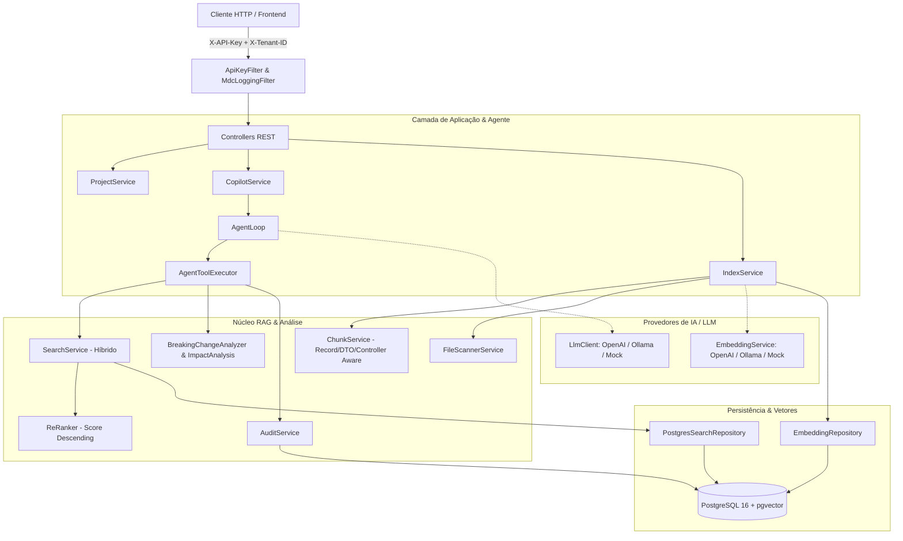

# CC Copilot Properties

Copiloto técnico autônomo e motor RAG para análise de projetos de software Java/Spring. O sistema indexa código-fonte local ou via upload ZIP, gera embeddings vetoriais com pgvector, executa busca híbrida (vetorial + simbólica exata) e utiliza um loop agêntico autônomo com chamada de ferramentas (Function Calling) para responder perguntas técnicas, diagnosticar breaking changes e auditar DTOs de API.

---

## 🏛️ Arquitetura do Sistema



### Principais Características
1. **Loop Agêntico Autônomo:** Não há intenções hardcoded; o agente decide sozinho quais ferramentas acionar iterativamente até formular a resposta final com cálculo de confiança.
2. **Busca Híbrida & Re-Ranking:** Combina busca semântica por proximidade de cosseno com busca simbólica exata por palavras-chave relevantes, reordenando candidatos por score decrescente.
3. **Chunking Inteligente:** Nunca fragmenta DTOs, reconhece Records do Java, sufixos case-insensitive (`DTO`, `Dto`, `Request`), anotações Lombok (`@Data`, `@Value`, `@Getter`) e inclui overlap contínuo para evitar quebra de código.
4. **Detecção Rigorosa de Breaking Changes:** Desacopla uso interno de contrato público. Se um DTO está exposto em `@RestController`, qualquer remoção, renomeação, mudança de tipo ou inclusão de campo obrigatório (`@NotNull`, `@NotBlank`) é classificada como **BREAKING CHANGE**.
5. **Indexação Incremental (SHA-256):** Calcula hash dos arquivos e apenas re-processa o que foi de fato alterado, limpando automaticamente arquivos removidos.
6. **Segurança Hardened & Multitenancy:** Isolamento estrito por `tenantId` em todas as consultas e tabelas, proteção contra Zip Bomb e Path Traversal em uploads, e autenticação com tempo constante.
7. **Observabilidade Nativa:** Health checks do PostgreSQL/pgvector e provedor LLM, métricas Micrometer para tempos de RAG e contagens de consultas, e logs estruturados com MDC (`tenantId`, `requestId`).

---

## 🛠️ Pré-requisitos

- **Java 17** ou superior
- **Docker** e **Docker Compose**
- Chave de API da OpenAI (opcional caso utilize o perfil `mock` ou `ollama`)

---

## 🚀 Inicialização Rápida

### 1. Subir o Banco de Dados (PostgreSQL + pgvector)

O `compose.yaml` já está configurado na porta padronizada `5434`:

```bash
docker compose up -d
```

### 2. Configurar Variáveis de Ambiente

Copie o arquivo de exemplo:

```bash
cp .env.example .env
```

Configurações padrão recomendadas no `.env`:
```env
DB_URL=jdbc:postgresql://localhost:5434/copilot
DB_USERNAME=postgres
DB_PASSWORD=postgres
API_KEY=local-dev-key
INDEXER_BASE_PATH=.
```

---

## 🎭 Perfis de Execução

### Perfil Mock (Recomendado para Desenvolvimento Local)
Sem custos e sem dependência de internet. Simula o LLM e embeddings localmente:
```bash
./gradlew bootRun --args='--spring.profiles.active=mock'
```

### Perfil OpenAI (Produção)
Utiliza `gpt-4o-mini` e embeddings `text-embedding-3-small` (1536 dimensões):
```bash
OPENAI_API_KEY=sk-proj-... SPRING_PROFILES_ACTIVE=openai ./gradlew bootRun
```

### Perfil Ollama (100% Local com IA Open-Source)
Utiliza modelos locais como `qwen2.5-coder` e `nomic-embed-text`:
```bash
SPRING_PROFILES_ACTIVE=ollama OLLAMA_BASE_URL=http://localhost:11434 ./gradlew bootRun
```

---

## 🔒 Autenticação e Multitenancy

Todas as requisições para a API (exceto Swagger e Actuator) exigem autenticação via header:
- `X-API-Key`: Chave configurada em `API_KEY`.
- `X-Tenant-ID`: Identificador do tenant para isolamento de dados (padrão: `default`).
- `X-Request-ID`: ID opcional para rastreamento distribuído (gerado automaticamente se ausente).

---

## 📡 Guia de Endpoints e Exemplos cURL

### 1. Cadastrar um Projeto
O `rootPath` deve ser um diretório existente dentro de `INDEXER_BASE_PATH`:
```bash
curl -X POST http://localhost:8080/projects \
  -H "Content-Type: application/json" \
  -H "X-API-Key: local-dev-key" \
  -d '{
    "tenantId": "hospital-central",
    "name": "modulo-prescricao",
    "rootPath": "./src"
  }'
```

### 2. Upload de Projeto via ZIP (com Proteção contra Zip Bomb)
```bash
curl -X POST http://localhost:8080/projects/upload \
  -H "X-API-Key: local-dev-key" \
  -F "file=@codigo-fonte.zip" \
  -F "tenantId=hospital-central" \
  -F "name=servico-faturamento"
```

### 3. Iniciar Indexação Assíncrona
```bash
curl -X POST http://localhost:8080/projects/{projectId}/index/async \
  -H "X-API-Key: local-dev-key"
```
Resposta imediata (HTTP 202 Accepted):
```json
{
  "jobId": "f7d456b3-...",
  "tenantId": "hospital-central",
  "knowledgeBase": "modulo-prescricao",
  "status": "SUBMITTED",
  "totalFiles": 0,
  "processedFiles": 0,
  "progressPercent": 0
}
```

### 4. Consultar Progresso da Indexação
```bash
curl -X GET http://localhost:8080/projects/{projectId}/index/status \
  -H "X-API-Key: local-dev-key"
```

### 5. Fazer Perguntas ao Copiloto
```bash
curl -X POST http://localhost:8080/projects/{projectId}/ask \
  -H "Content-Type: application/json" \
  -H "X-API-Key: local-dev-key" \
  -d '{
    "question": "Posso remover o campo dosagem do MedicamentoDTO?",
    "sessionId": "sessao-dev-01"
  }'
```
Resposta com fontes e análise de impacto:
```json
{
  "answer": "A remoção do campo `dosagem` no MedicamentoDTO constitui uma **BREAKING CHANGE CRÍTICA** pois este DTO é utilizado no endpoint POST `/api/medicamentos` de PrescricaoController. Recomenda-se criar uma versão v2 da rota.",
  "confidence": 0.95,
  "sources": [
    { "path": "MedicamentoDTO.java", "score": 1.0 },
    { "path": "PrescricaoController.java", "score": 0.92 }
  ]
}
```

### 6. Histórico Paginado de Interações
```bash
curl -X GET "http://localhost:8080/history?tenantId=hospital-central&page=0&size=10" \
  -H "X-API-Key: local-dev-key"
```

### 7. Métricas de Auditoria de DTOs
```bash
curl -X GET "http://localhost:8080/copilot/audit/dtos?tenantId=hospital-central" \
  -H "X-API-Key: local-dev-key"
```

---

## 📊 Observabilidade e Saúde

### Health Check Detalhado
```bash
curl -X GET http://localhost:8080/actuator/health
```
Exemplo de resposta:
```json
{
  "status": "UP",
  "components": {
    "db": { "status": "UP" },
    "diskSpace": { "status": "UP" },
    "pgVector": {
      "status": "UP",
      "details": { "extension": "vector", "status": "installed" }
    },
    "llmProvider": {
      "status": "UP",
      "details": { "provider": "mock", "mode": "local-development" }
    }
  }
}
```

### Métricas Micrometer
- `GET /actuator/metrics/rag.embedding.time`
- `GET /actuator/metrics/rag.search.time`
- `GET /actuator/metrics/rag.queries.total`

### Swagger / Documentação Interativa OpenAPI
Acesse pelo navegador:
```
http://localhost:8080/swagger-ui/index.html
```

---

## 🧪 Execução de Testes

Para executar toda a suíte de testes com validações de segurança, multitenancy, RAG, breaking changes e indexação incremental:

```bash
./gradlew test
```
